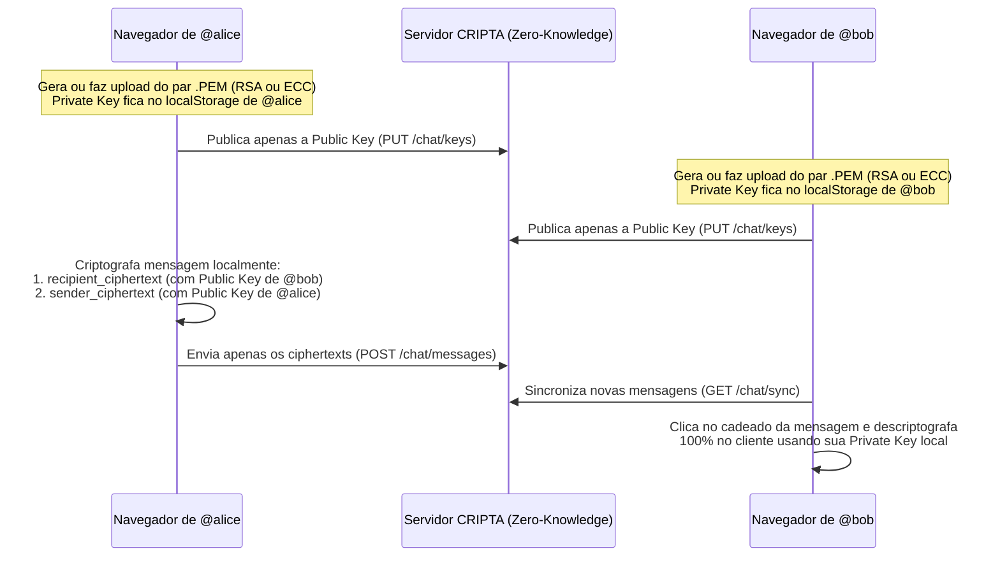

# CRIPTA — Chat com Criptografia de Ponta a Ponta (E2EE)

**CRIPTA** é uma plataforma de mensagens com **Criptografia de Ponta a Ponta (E2EE)** e arquitetura **Zero-Knowledge Server**, onde cada usuário tem controle total sobre o seu próprio par de chaves assimétricas (**RSA-OAEP 2048** ou **ECC ECDH P-256 + AES-GCM**).

Toda geração de chaves, validação de arquivos `.PEM`, criptografia e descriptografia acontecem **100% no navegador (Client-Side)** via **Web Crypto API**. O servidor armazena exclusivamente a `Public Key` e os *ciphertexts* das mensagens — a `Private Key` jamais trafega pela rede nem é armazenada no banco de dados.

---

## Principais Funcionalidades

- **Criptografia Ponta a Ponta (RSA & ECC)**:
  - **RSA**: `RSA-OAEP` (2048 bits, `SHA-256`) + envelopamento híbrido `AES-GCM` (256 bits) para mensagens de qualquer tamanho.
  - **ECC**: `ECDH` (curva `P-256`) com chave efêmera por mensagem + derivação `AES-GCM` (256 bits).
- **Gerenciamento Total de Chaves pelo Usuário (`.PEM`)**:
  - Geração instantânea de pares de chaves no navegador com 1 clique.
  - Exportação/download do par de chaves em formato padrão `.PEM` (`PUBLIC KEY` / `PRIVATE KEY`).
  - **Detecção Inteligente de Chaves da Conta**: ao entrar em outro navegador ou dispositivo, o sistema detecta automaticamente se a conta já possui uma `Public Key` registrada e exibe os botões de **Upload da Chave (`.PEM`)** (validando o par localmente) ou **Gerar Nova Chave**.
- **Desbloqueio Interativo por Cadeado**:
  - As mensagens chegam trancadas exibindo o preview do *ciphertext* e um cadeado interativo (`game-icons:padlock` → `game-icons:unlocking` no *hover* → `game-icons:padlock-open` quando descriptografada localmente).
- **Identidade Privada por `@handle` e Ícones de Perfil**:
  - O sistema não solicita nem armazena o nome completo dos usuários. Toda identificação e adição de contatos é feita exclusivamente pelo `@handle`.
  - Sem upload de fotos de perfil por privacidade: o usuário escolhe entre **12 ícones exclusivos (`game-icons`)** (`witch-face`, `wizard-face`, `bad-gnome`, `dwarf-face`, `horse-head`, `cloaked-figure-on-horseback`, `deathcab`, `daemon-skull`, `spiked-dragon-head`, `pegasus`, `unicorn`, `william-tell-skull`).
- **Sincronização Dinâmica em Tempo Real**:
  - Recebimento automático de novas mensagens e novos contatos em segundo plano (`/chat/sync`) sem necessidade de recarregar a página e sem fechar mensagens já descriptografadas na tela.
- **Segurança de Conta & Internacionalização**:
  - Autenticação completa via **Laravel Fortify** com suporte a **Passkeys (WebAuthn)** e **Autenticação em Duas Etapas (2FA TOTP)**.
  - Interface bilíngue (**Português `PT`** e **Inglês `EN`**) com alternador em todas as páginas e suporte a tema Claro / Escuro (`slate-800` & `white`).

---

## Stack Tecnológica

| Camada | Tecnologias |
| :--- | :--- |
| **Backend** | PHP 8.3+, Laravel 13, Laravel Fortify, Spatie Laravel Passkeys, Laravel Wayfinder |
| **Frontend** | React 19 (React Compiler), TypeScript, Inertia.js v3, Tailwind CSS v4, Radix UI |
| **Criptografia** | Web Crypto API nativa do navegador (`window.crypto.subtle`) — `RSA-OAEP`, `ECDH P-256`, `AES-GCM` |
| **Infraestrutura** | Docker & Docker Compose (`app`, `node`, `nginx`, `mysql`, `redis`, `phpmyadmin`, `mailhog`) |
| **Qualidade & Testes** | PHPUnit 12, Larastan (PHPStan), Laravel Pint, Vite+ (`vp check`, `tsc --noEmit`) |

---

## Como Funciona a Criptografia E2EE no CRIPTA



---

## Executando o Projeto com Docker (Recomendado)

### Pré-requisitos
- **Docker** e **Docker Compose** instalados.

### Passo a passo

1. Clone o repositório e entre na pasta do projeto:
   ```bash
   git clone https://github.com/zedutra/cripta-chat.git
   cd cripta-chat
   ```

2. Copie o arquivo de variáveis de ambiente:
   ```bash
   cp .env.example .env
   ```

3. Suba os containers Docker:
   ```bash
   docker compose up -d --build
   ```

4. Instale as dependências PHP, gere a chave da aplicação e execute as migrations dentro do container `app`:
   ```bash
   docker compose exec app composer install
   docker compose exec app php artisan key:generate
   docker compose exec app php artisan migrate
   ```

5. Acesse os serviços no navegador:
   - **Aplicação CRIPTA**: http://localhost:8000
   - **Vite Dev Server (HMR)**: http://localhost:5173
   - **phpMyAdmin**: http://localhost:8081
   - **MailHog (E-mails locais)**: http://localhost:8025

---

## Executando Localmente (Sem Docker)

1. Instale as dependências do PHP e do Node.js:
   ```bash
   composer install
   npm install
   ```

2. Configure o `.env` e o banco de dados:
   ```bash
   cp .env.example .env
   php artisan key:generate
   php artisan migrate
   ```

3. Inicie o servidor de desenvolvimento integrado:
   ```bash
   composer run dev
   ```

---

## Comandos de Qualidade e Testes

```bash
# Checagem de tipos TypeScript
npm run types:check

# Padronização de código PHP (Laravel Pint)
composer run lint

# Análise estática PHP (Larastan / PHPStan)
composer run types:check

# Executar suíte de testes automatizados (PHPUnit)
php artisan test

# Pipeline completo de verificação (CI)
composer run ci:check
```

---

## Documentação Adicional

Consulte o documento [ARCHITECTURE.md](ARCHITECTURE.md) para detalhes sobre a organização das camadas do backend (`Actions`, `DTOs`, `Enums`, `Controllers`) e dos módulos do frontend (`features/chat`).
